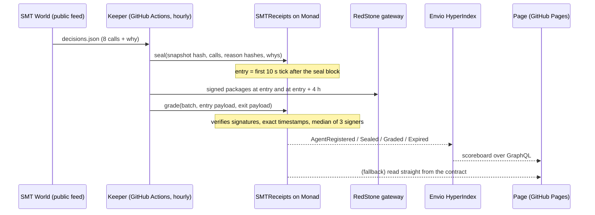

# SMT Receipts

**An AI trading bot's calls, sealed on Monad before the market moves and graded later by RedStone-signed prices. Nobody can edit them, including us.**

Built for [Monad Metropolis](https://monad.xyz/metropolis), track **Onchain Finance & Trading**.

| | |
|---|---|
| Live page | https://jannetekka.github.io/monad-hack/ |
| Contract (Monad testnet, chain 10143) | [`0xDF9f42AE4f81F086F8495c5a5339dDaa90057993`](https://testnet.monadvision.com/address/0xDF9f42AE4f81F086F8495c5a5339dDaa90057993) |
| Keeper runs | [Actions → keeper](../../actions/workflows/keeper.yml) (hourly) |
| Archived snapshots | [`archive` branch](../../tree/archive/batches) |
| Indexer | Envio HyperIndex, [`indexer/`](indexer/), GraphQL at https://indexer.dev.hyperindex.xyz/e5478c3/v1/graphql |
| Demo video (1:48) | https://youtu.be/7IpMa2UPJPk |
| Pitch video (1:51) | https://youtu.be/KYqEICJNxeA |
| Submitted | Monad Metropolis, 2026-10-14 |

## The problem

Anyone selling trading calls (a Telegram group, an influencer, an "AI signal" bot) can delete the ones that went wrong. A screenshot proves nothing, a self-reported win rate proves less, and a bot that reports its own grades is marking its own exam. Most people can't tell a good track record from a curated one, so they trust the loudest.

[SMT (Smart Money Trading)](https://smt-weex-trading-bot.jannet-ekka.workers.dev/) is an explainable AI trading bot: a committee of specialist agents votes on eight coins, and a judge publishes the verdict with a plain-language reason. SMT's pitch has always been *a decision you can audit*. SMT Receipts makes that literal.

## What it does

1. **Publish.** Every hour SMT World publishes the committee's call on BTC, ETH, SOL, BNB, XRP, DOGE, LTC and ADA: LONG, SHORT or WAIT, a conviction, and a three-sentence "why".
2. **Seal.** A keeper writes the whole snapshot to `SMTReceipts` on Monad: all eight calls, WAITs included, the hash of each call's published reasoning, the hash of the snapshot, and the plain-language reason for every LONG and SHORT.
3. **Price.** Entry is the first RedStone price tick strictly *after* the seal block; exit is entry + 4 hours. RedStone signs a price for each coin every 10 seconds.
4. **Grade.** Anyone submits the RedStone packages signed at those two exact seconds. The contract checks three of RedStone's five signatures itself, takes the median, computes the move, subtracts the round-trip fee SMT declared at registration (12 bp) and keeps score.
5. **Show.** An Envio HyperIndex indexer turns the events into a scoreboard; the page shows every receipt and lets anyone recompute its hashes in the browser.

### Two records: what SMT says, and what SMT holds

The committee's calls are advisory; SMT's written setups decide its trades. So the contract carries a second agent, **"SMT - live positions"** (agent 2), with its own scoreboard and its own tab on the page:

- The keeper reads `live.open[]` from SMT World's `account.json` and keeps seven fields per position: pair, side, entry, opened_at, setup_name, lane, leverage. No size, equity, mark or PnL leaves the file, and `paper.open` is never read.
- A held position is sealed as its side, with the reason *"held position, opened &lt;opened_at&gt; by &lt;setup_name&gt;"*, and graded from the seal over the same horizon, net of the same 12 bp fee. A coin SMT doesn't hold (or holds both ways) is a WAIT.
- It seals once per horizon, so no two receipts grade the same price move, and at once when a position opens or closes.
- It signs with a key derived from the keeper's (`keccak256(key ‖ "smt-receipts/positions")`), so there is still one secret; the keeper tops that wallet up and logs `[FUND]`.



## What can't be faked, and why

| Claim | Enforced by |
|---|---|
| The call existed before its entry price | Entry is the first RedStone tick strictly after the seal block's timestamp (`_entryTs`). |
| The grade uses real prices, not ours | `grade()` recovers each package's signer, accepts only RedStone's five `redstone-primary-prod` signers, needs 3 distinct signers per coin, and requires every package to carry exactly the entry or exit timestamp. |
| No cherry-picking of calls | Every batch must cover every pair the agent registered (`LengthMismatch`), WAITs included. A snapshot can be sealed once, in order, and only while it is under 3 hours old (`StaleSource`). |
| No dropping of bad calls | A batch that isn't graded within 22 hours expires (`expire()`, callable by anyone) and every LONG/SHORT in it counts as a miss that paid its fee. |
| No editing afterwards | No owner, no admin key, no upgrade path, no setter. Deployed through the canonical CREATE2 proxy, so the address is fixed by the code itself. |
| The reason is the one SMT published | Each line's `reasonHash` is `keccak256` of the canonical JSON of SMT World's row for that coin; the keeper archives the exact snapshot bytes, whose hash is sealed too. The page recomputes both. |

**Honest limits.** The keeper decides *when* to seal (hourly; a skipped hour is a visible gap) and which three of the five RedStone signers to submit (it always takes the three lowest-index valid ones; a different choice moves the median by at most the spread between signers, typically well under 1 bp against a 12 bp fee). Agent 1 grades SMT's public committee verdicts, which SMT itself labels advisory. Agent 2 grades the positions SMT holds, one 4-hour window at a time: a receipt says whether price moved the held way after the seal, not what the trade made (sizes, exits and PnL stay private). Its sealed snapshot is the keeper's extract of `account.json`, not the file's bytes (the file changes hourly and holds private fields), so it shows what the keeper read, at the time it read it. RedStone's public gateway keeps about 24 hours of signed history, which is why the grading window is 22 hours.

## Why Monad

A receipt is only worth something if *every* call gets one, including the dull WAITs, every hour, forever. That is eight calls per transaction, 24 transactions a day, plus a grading transaction carrying a dozen signed price packages, which is cheap and fast enough on Monad to be a non-event. Seals land within seconds of the keeper reading the feed, and the entry tick follows within 10 seconds.

Measured gas (EVM schedule, Hardhat; Monad reprices cold storage and `ecrecover`, so budget about 25–40% more):

| Call | Gas |
|---|---|
| deploy (once) | 2,289,514 |
| `registerAgent` (once) | 418,044 |
| `seal`, 8 pairs, 1 LONG/SHORT | 95,545 |
| `grade`, 1 pair / 2 pairs / 3 pairs | 113,772 / 174,662 / 236,118 |

Monad charges the gas *limit*, so the keeper sets each limit to the estimate + 20%.

## Repository

| Path | What |
|---|---|
| [`contracts/SMTReceipts.sol`](contracts/SMTReceipts.sol) | The contract, including a self-contained RedStone payload verifier (MIT) |
| [`lib/`](lib/) | Shared JS: RedStone package fetch, local signature check and payload builder; receipt canonicalisation; CREATE2 address |
| [`keeper/keeper.js`](keeper/keeper.js) | Deploy if needed → register → seal → grade → expire. One tagged log line per action |
| [`indexer/`](indexer/) | Envio HyperIndex (V3): `Agent`, `Batch`, `Receipt`, `PairStat` |
| [`web/`](web/) | The page: static HTML/JS, reads Envio or the chain, verifies receipts in the browser |
| [`test/`](test/) | Contract tests, including real RedStone signatures and a real SMT World snapshot |
| [`scripts/e2e-local.js`](scripts/e2e-local.js) | Full rehearsal on a local chain running 6 hours behind real time, graded with RedStone's real history |
| [`docs/SETUP.md`](docs/SETUP.md) | The one-time setup (wallet, secret, faucet, Pages, Envio) |

## Run it

```bash
npm ci
npx hardhat compile
npm test                    # 18 contract tests
npm run e2e                 # deploy → register both agents → seal → grade against RedStone's real signed history
npm run keeper:dry          # read the live feed and Monad testnet, build every transaction, send nothing
cd indexer && pnpm install && pnpm codegen && pnpm test
```

`node scripts/e2e-local.js --serve` leaves the rehearsal chain up and prints a local URL for the page.

## Data and keys

- **Input:** only SMT World's public feeds: `decisions.json` (the committee) and, for the positions agent, seven fields of each live position in `account.json`. No SMT parameters, research, sizes, balances or PnL are published.
- **Prices:** RedStone's public gateway (`redstone-primary-prod`), no API key.
- **Chain:** Monad testnet only. The keeper wallet is fresh, holds only free testnet MON from QuickNode's faucet, and its key exists only as a GitHub environment secret.

## Built during Metropolis

Everything in this repository was written for Metropolis in October 2026 (see the commit history). SMT itself is an existing project; this repository only reads its public feed.

Built with [Claude Code](https://claude.ai/code) as a coding assistant.

## License

[MIT](LICENSE)
